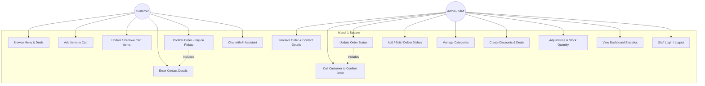

# Use Case Diagram — Mandi 1 Restaurant Website

**Actors**
- **Customer** — any site visitor placing a takeaway order.
- **Admin / Staff** — restaurant staff who manage the menu and confirm orders by phone.

**Key flow:** Customer browses → adds to cart → confirms order (provides name, phone, email) →
Admin receives the order in the staff dashboard → Admin calls the customer to confirm →
Admin updates the order status (Confirmed → Completed).
